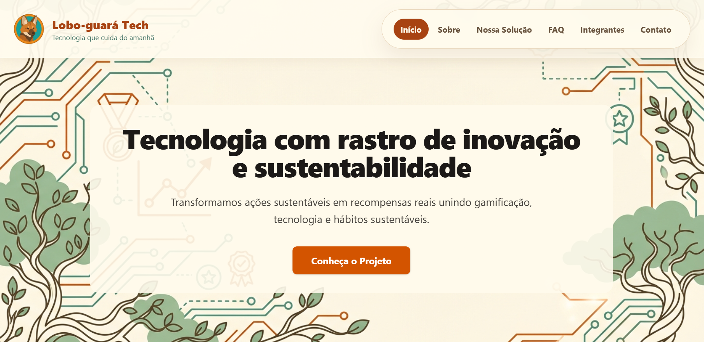
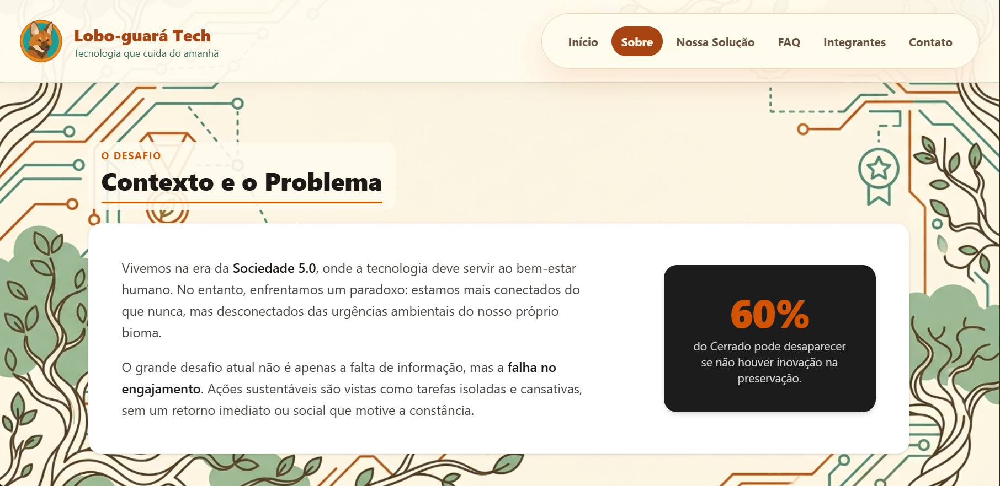
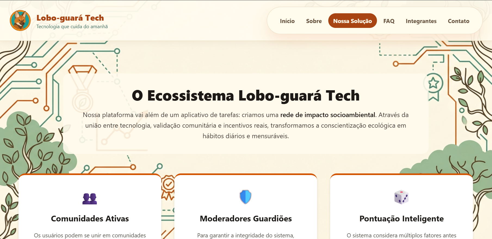
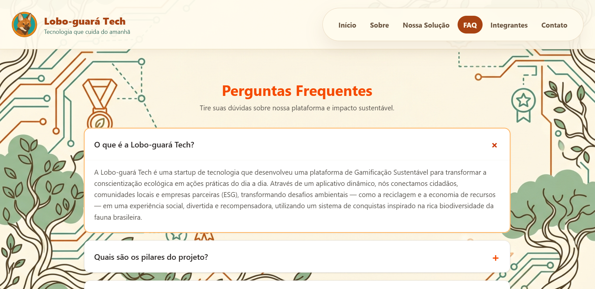
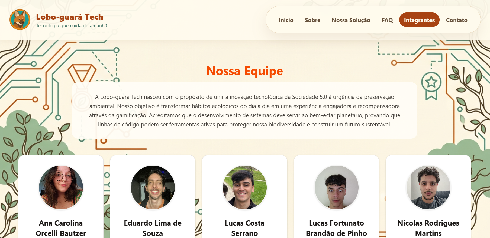
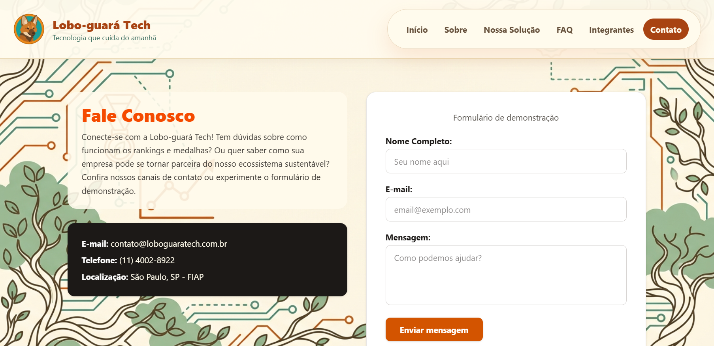

# Lobo-guará Tech | Tecnologia com Rastro de Inovação e Sustentabilidade

<p align="center">
  
</p>

## 📄 Descrição do Projeto e Objetivo

O projeto Lobo-guará Tech busca solucionar a dificuldade de engajamento ecológico ao transformar atitudes ecológicas em um ciclo contínuo de motivação. Indo ao encontro da junção entre as inovações incremental e disruptiva, a plataforma conecta mecanismos tecnológicos já existentes às lacunas presentes na sustentabilidade. Criamos, assim, um Sistema de Gamificação Sustentável integrado, desenvolvido para converter o impacto ambiental positivo dos usuários em recompensas tangíveis e reconhecimento por meio de rankings e desafios dinâmicos.

O objetivo deste trabalho é consolidar uma solução que coloque o usuário no centro da resolução de problemas ambientais. A proposta visa tornar a sustentabilidade não apenas uma escolha consciente, mas um hábito diário reforçado por incentivos reais. Dessa forma, a plataforma entrega uma ferramenta capaz de escalar o impacto ecológico de maneira ágil, transformando o compromisso com o planeta em uma experiência digital altamente recompensadora.

Nesta Sprint 4, o site passa a ter o **Simulador Lobo-guará Tech**, que consome a **API Java (Spring Boot)** e a **API de IA (Python)** do grupo. Ele tem três abas:

* **Celular:** o aplicativo Soul Up funcionando dentro de um celular, com cadastro, login, postagens de ações sustentáveis, comunidades, moderação, ranking, carteira de pontos e benefícios. Ao lado, um painel explica cada tela e mostra o endpoint usado.
* **Status da API:** a situação da API Java e da API de IA, com a lista dos endpoints e das telas que chamam cada um.
* **Admin (IA):** visão de administração que usa o modelo de IA para prever o risco de abandono de um usuário.

## 🛠️ Tecnologias Utilizadas

* **React:** interface como Single Page Application (SPA), com componentes reutilizáveis e hooks (`useState`, `useEffect`, `useContext`, `useCallback`).
* **TypeScript:** tipagem estática de componentes, dados e respostas das APIs (inclusive com `Pick` e `Omit`).
* **Vite:** servidor de desenvolvimento e build da aplicação.
* **React Router:** rotas estáticas, rota dinâmica com parâmetro (`/integrantes/:rm`), rotas aninhadas com `Outlet` no simulador e redirecionamento de rotas inexistentes para a Home.
* **Context API:** estado do simulador e registro das requisições, com hooks próprios (`useSimulador` e `useRequisicoes`).
* **Fetch API:** consumo da API Java e da API de IA com `GET`, `POST`, `PUT`, `PATCH` e `DELETE`, tratamento de erros e de status de resposta.
* **React Hook Form:** validação dos formulários (Contato e telas do simulador).
* **Tailwind CSS:** estilização e responsividade para celular, tablet e desktop.
* **React Icons:** ícones da interface.
* **json-server:** API local de apoio (`db.json`) para testar o front sem a API Java.
* **API Java (Spring Boot):** back-end do projeto, publicado no Render ([repositório](https://github.com/Challenger-2026/java-api)).
* **API de IA (Python/Flask):** modelo de risco de abandono, publicado no Render.
* **Git, GitHub e Git Flow:** versionamento com branches `feature/` a partir da `develop`, pull requests e releases na `main`.
* **Vercel:** deploy da aplicação.

## 🚀 Como Usar

### Links do projeto

* 🔗 **Repositório no GitHub:** [github.com/Challenger-2026/front-3.0](https://github.com/Challenger-2026/front-3.0)
* 🌐 **Aplicação na Vercel:** [https://lobo-guara-swart.vercel.app/](https://lobo-guara-swart.vercel.app/)
* 📹 **Vídeo no YouTube:** [COLOCAR_LINK_DO_VIDEO](COLOCAR_LINK_DO_VIDEO)

### Como executar

```bash
git clone https://github.com/Challenger-2026/front-3.0.git
cd front-3.0
npm install
cp .env.example .env
npm run dev
```

No arquivo `.env`, escolha qual API Java o front vai usar:

```env
# json-server (db.json), rodando com "npm run backend"
VITE_API_URL=http://localhost:5000
# API Java no seu computador
# VITE_API_URL=http://localhost:8080
# API Java publicada no Render
# VITE_API_URL=https://guara-api.onrender.com

# API de IA (Python)
VITE_API_IA_URL=https://lobo-guara-ia.onrender.com
```

Para usar o json-server, rode `npm run backend` em outro terminal. Os demais comandos:

* `npm run build` – confere os tipos e gera a versão final;
* `npm run lint` – verifica as regras de código;
* `npm run preview` – abre a versão gerada pelo build.

### O que testar

* Navegue pelas páginas pelo menu: Home, Sobre, Solução, FAQ, Integrantes, Contato e Simulador.
* Em **Integrantes**, clique em uma pessoa para abrir o painel com a rota `/integrantes/:rm`.
* No **Simulador**, crie uma conta, faça login, publique uma ação sustentável e acompanhe o painel de requisições.
* Na aba **Status da API**, veja se as APIs estão no ar e quais endpoints cada tela usa.
* Na aba **Admin (IA)**, sorteie um usuário de teste e veja a previsão de risco de abandono.
* Confira o layout em celular, tablet e desktop.

**Observação:** as APIs estão no plano gratuito do Render e podem levar alguns segundos para responder na primeira chamada.

## 📂 Estrutura de Pastas do Projeto

```text
front-3.0/
├── public/                         # Favicon, imagens e vídeos da página Solução
│
├── src/
│   ├── assets/                     # Logotipo, fotos dos integrantes, ícones e prints das páginas
│   │
│   ├── components/                 # Componentes reutilizáveis
│   │   ├── Header.tsx              # Cabeçalho e navegação
│   │   ├── Footer.tsx              # Rodapé
│   │   ├── CardIntegrante.tsx      # Card dos integrantes
│   │   ├── FaqItem.tsx             # Item do accordion do FAQ
│   │   ├── Reveal.tsx              # Animação de entrada dos blocos
│   │   ├── ...                     # Botões, cards e linha do tempo
│   │   └── simulador/              # Componentes do simulador
│   │       ├── Celular.tsx         # Moldura do celular
│   │       ├── PainelExplicacao.tsx  # Explicação e endpoint de cada tela
│   │       ├── PainelRequisicoes.tsx # Requisições às APIs ao vivo
│   │       ├── telas/              # Telas do app (cadastro, login, postagens, ranking...)
│   │       └── admin/              # Componentes da aba Admin (IA)
│   │
│   ├── context/                    # SimuladorContext e RequisicoesContext
│   ├── hooks/                      # useSimulador e useRequisicoes
│   ├── services/                   # Chamadas às APIs
│   │   ├── http.ts                 # Função única com o fetch e o registro das requisições
│   │   ├── api.ts                  # Endpoints da API Java
│   │   └── apiIa.ts                # Endpoints da API de IA
│   ├── data/                       # Dados fixos (endpoints, benefícios, explicações...)
│   ├── utils/                      # Validações, formatadores e mensagens de erro
│   │
│   ├── pages/                      # Páginas da aplicação
│   │   ├── Home.tsx
│   │   ├── Sobre.tsx
│   │   ├── Solucao.tsx
│   │   ├── Faq.tsx
│   │   ├── Integrantes.tsx         # Lista e painel do integrante (/integrantes/:rm)
│   │   ├── Contato.tsx
│   │   ├── Simulador.tsx           # Abas do simulador (Outlet)
│   │   ├── SimuladorCelular.tsx    # Aba Celular
│   │   ├── StatusApi.tsx           # Aba Status da API
│   │   └── SimuladorAdmin.tsx      # Aba Admin (IA)
│   │
│   ├── types/types.ts              # Tipos TypeScript
│   ├── App.tsx                     # Layout com Header, Outlet e Footer
│   ├── main.tsx                    # Rotas (createBrowserRouter) e entrada da aplicação
│   └── index.css                   # Tailwind e estilos globais
│
├── db.json                         # Dados do json-server
├── .env.example                    # Modelo das variáveis de ambiente
├── vercel.json                     # Redirecionamento das rotas da SPA na Vercel
├── package.json                    # Dependências e scripts
├── vite.config.ts                  # Configuração do Vite
├── tsconfig*.json                  # Configurações do TypeScript
├── eslint.config.js                # Configuração do ESLint
└── README.md                       # Este arquivo
```

## 👥 Autores e Créditos

Equipe **Lobo-guará Tech**, estudantes de **Análise e Desenvolvimento de Sistemas (ADS)** da **FIAP**:

| Foto | Nome | RM | Turma | Função | Links |
| :---: | --- | :---: | :---: | --- | --- |
|  | Ana Carolina Orcelli Bautzer | 570281 | 1TDSPI | Líder de Projeto | [LinkedIn](https://www.linkedin.com/in/ana-bautzer/) · [GitHub](https://github.com/anabautzer) |
|  | Eduardo Lima de Souza | 570412 | 1TDSPI | Front-End | [LinkedIn](https://www.linkedin.com/in/duduulimatech/) · [GitHub](https://github.com/duduutech) |
|  | Lucas Costa Serrano | 571016 | 1TDSPI | Python | [LinkedIn](https://www.linkedin.com/in/lucas-costa-serrano-647327278/) · [GitHub](https://github.com/luckz4) |
|  | Lucas Fortunato Brandão de Pinho | 572860 | 1TDSPI | ChatBot e IA | [LinkedIn](https://www.linkedin.com/in/lucas-fortunato-317643397/) · [GitHub](https://github.com/Loutcoun) |
|  | Nicolas Rodrigues Martins | 573178 | 1TDSPW | Java e Python | [LinkedIn](https://www.linkedin.com/in/nicolas-rodrigues-martins-126607360/) · [GitHub](https://github.com/NickRM22) |

## 📸 Imagens e Representação do Projeto

As imagens estão na pasta `src/assets`.

### 💻 1. Página Inicial (Home)

*Legenda: seção principal com a proposta do projeto e acesso às demais páginas.*

### 📄 2. Página Sobre

*Legenda: contexto e problema, tipos de solução e roadmap de desenvolvimento.*

### 🚀 3. Página Solução

*Legenda: explicação do ecossistema de gamificação, regras e dinâmica de pontuação.*

### 📱 4. FAQ

*Legenda: perguntas frequentes em accordion.*

### 👥 5. Integrantes

*Legenda: cards da equipe com fotos e links; ao clicar, abre o painel com a contribuição de cada pessoa.*

### ✉️ 6. Contato

*Legenda: formulário com validação dos campos.*

## 📞 Contato

Para dúvidas sobre o projeto, entre em contato com a equipe:

* **E-mail:** contato@loboguaratech.com.br
* **Página de Contato:** disponível na aplicação, em `/contato`
* **Integrantes:** LinkedIn e GitHub de cada pessoa na tabela de [Autores e Créditos](#-autores-e-créditos)